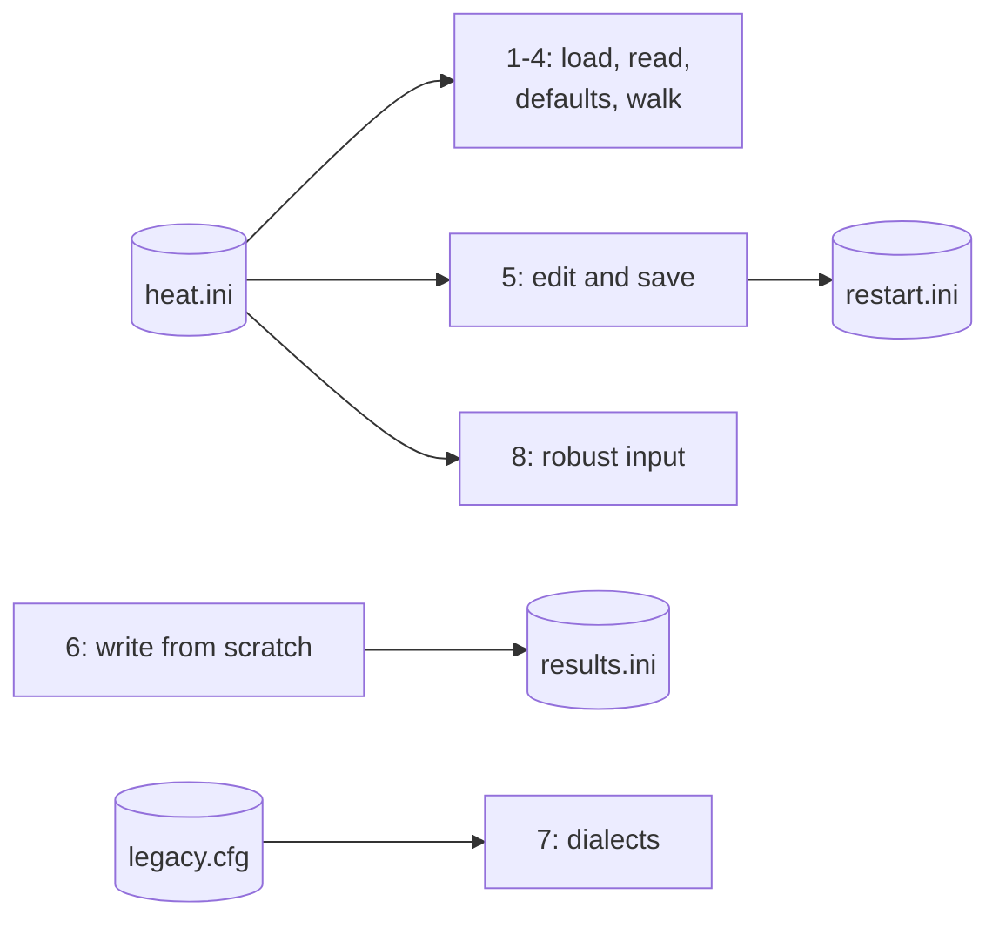

# The tutorial

The tutorial teaches FiNeR by building one program, step by step. The [cookbook](./cookbook) then collects short
recipes for everyday tasks, and the [reference](/guide/features#feature-map) covers every method and every argument.

## The chapters

The tutorial builds `heat`, the input and output of a (pretend) heat conduction solver. It reads its case file, checks
it, edits it and saves a restart file, then writes its results from scratch. Each chapter is a complete program that
you can compile and run, and every output shown is the real output of that program.

| Chapter | You learn |
|---|---|
| [1. A first file](./tutorial/01-first-file) | `file_ini`, `load(source=)`, `get`, `print` |
| [2. Reading the case file](./tutorial/02-reading) | `load(filename=)`, typed values, the global section, lists, `count_values` |
| [3. Optional settings](./tutorial/03-defaults) | `default=`, `get_string`, `has_section`, `has_option` |
| [4. Walking the file](./tutorial/04-walking) | `sections_number`, `section`, `get_sections_list`, `loop`, `get_items`, `index` |
| [5. Editing and saving](./tutorial/05-editing) | `add` to update or append, `del`, `save`, `retain_comments`, how reals are written |
| [6. Writing from scratch](./tutorial/06-writing) | `add` for sections, scalars, arrays and complex numbers; `print(pref=)` |
| [7. Other INI dialects](./tutorial/07-dialects) | `separator=`, comment styles, the `[]` header, dotted names, CRLF files |
| [8. Robust input](./tutorial/08-robust) | the error codes, values left unchanged, the status of `save` |

The chapters read and write these files (run them in order: chapter 5 writes `restart.ini`, chapter 6 `results.ini`):



`heat.ini`, the case file of the whole tutorial:

<<< @/examples/files/heat.ini{ini}

## Building the chapters

Each chapter is one file of
[`docs/examples/src`](https://github.com/szaghi/FiNeR/tree/master/docs/examples/src), `heat_1.f90` to `heat_8.f90`.
Build FiNeR as a static library, then compile a chapter against it:

```bash
fobis build --mode finer-static-gnu                     # static/libfiner.a and static/mod/
gfortran -Istatic/mod docs/examples/src/heat_2.f90 static/libfiner.a -o heat
cd docs/examples/files && ../../../heat                 # the chapters read their files from the current directory
```

`scripts/docs_examples.sh` does this for every program of the documentation and regenerates the outputs these pages
show. The *Docs examples* workflow runs it on every push and fails if an output changes, so the pages cannot drift
from the code.

## The cookbook

Short, complete programs answering "how do I ...?": reading, exploring, writing, the INI dialects and errors. See the
[cookbook](./cookbook).
